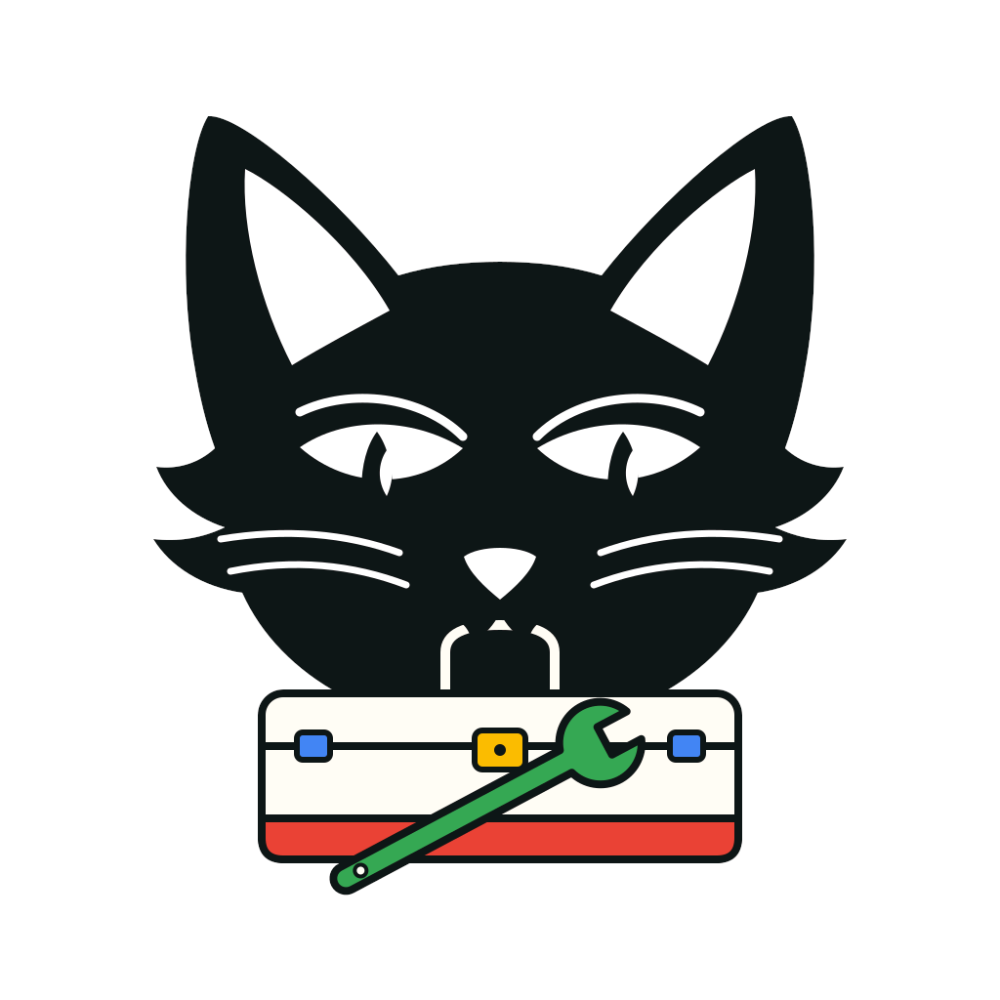

<!-- SPDX-FileCopyrightText: 2026 Blackcat Informatics® Inc. <paudley@blackcatinformatics.ca> -->
<!-- SPDX-License-Identifier: CC-BY-4.0 -->

<p align="center">
  
</p>

# RAF — Rust Agentic Foundations

RAF is a set of dev-dependency libraries and cargo subcommands, not yet
published, that keep Rust
repositories free of duplicated helpers and keep their documentation an accurate,
current account of the system. A census finds near-duplicate helper code and
ratchets recorded debt down; a spec-first workplan reconciles capability documents
with the code, tests and examples that implement them. Both are built to be driven
by humans and coding agents alike, and both fail hard with a message that says how
to fix the problem.

## Crates

Delivered contracts and the remaining Census designs are listed in the
[capability catalogue](docs/capabilities/index.md), with resolved bindings and
generated verification matrices. This repository runs the workplan gate on itself
(`tests/self_workplan.rs`) and runs the production Census gate over its workspace
and fuzz roots (`tests/self_census.rs`). The canonical `helpers-ledger.ttl` and
`census-debt.ttl` hold its policy and exact adopted duplication. The `use`-path resolution of `raf-source` is
checked against `rustc` on generated programs
(`crates/raf-source/tests/rustc_oracle.rs`).
`raf-workplan` delivers its document model, generated documentation blocks,
reconcile step, `verify` and completion gate, entity history, authored evidence metadata
and its claims, prose assessments, two-way coverage and the current-rationale
check, and `cargo-workplan` runs `check`, `status`, `docs sync|preview`,
`change new|impact|reconcile|complete`, `verify`, `history`,
`evidence claims|for`, `assess` and `coverage code|tests`: their contract
is stated in [workplan-cli](docs/capabilities/workplan-cli.md). The
[complete policy](docs/capabilities/workplan-strict.md) is delivered and applies
to every check, reconciliation and completion. It enforces section content,
package ownership, claims, line coverage and change outcomes, with explicit debt
recording that can only shrink.

`raf-census` delivers normal form 1, fingerprints, grouping, canonical RDF reports,
the strict ledger, the production Gate, counted debt and bounded migration.
`cargo-census` supplies native `check`, `job`, `count` and `fingerprint`
queries, `migrate` and direct `debt --write`. Complete detector/provider execution
retains its own capability state in the catalogue.

| Crate | Kind | Purpose | Status | Specification |
|---|---|---|---|---|
| `raf-okf` | library | Reads and writes the RAF profile of OKF documents. | **delivered** | [okf-profile](docs/capabilities/okf-profile.md) |
| `raf-rdf` | library | Canonical ground RDF 1.2 reports over native PurRDF storage. | **delivered** | [rdf-report-profile](docs/capabilities/rdf-report-profile.md) |
| `raf-source` | library | Indexes Rust source so tools can bind documents to code. | **delivered** | [source-index](docs/capabilities/source-index.md) |
| `raf-census` | library | The duplicate-helper census, strict ledger, counted debt, migration and Gate. | **delivered** for the capabilities listed — not yet published | [census-normal-form](docs/capabilities/census-normal-form.md), [census-ledger](docs/capabilities/census-ledger.md), [census-debt-ratchet](docs/capabilities/census-debt-ratchet.md), [census-migration](docs/capabilities/census-migration.md) |
| `cargo-census` | cargo subcommand | Runs native checks and job, count and fingerprint queries, migrates ledgers and writes admitted debt through the production Gate. | **complete command interface delivered** — not yet published | [census-migration](docs/capabilities/census-migration.md), [census-debt-ratchet](docs/capabilities/census-debt-ratchet.md), [census-cli](docs/capabilities/census-cli.md) |
| `raf-workplan` | library | The workplan document model, generated documentation blocks, reconcile step, completion gate, entity history, evidence and claims, prose assessments, two-way coverage and current rationale. | **delivered** for the capabilities listed — not yet published | [workplan-document-model](docs/capabilities/workplan-document-model.md), [workplan-generated-docs](docs/capabilities/workplan-generated-docs.md), [workplan-reconcile](docs/capabilities/workplan-reconcile.md), [workplan-complete-gate](docs/capabilities/workplan-complete-gate.md), [workplan-entity-history](docs/capabilities/workplan-entity-history.md), [workplan-evidence-claims](docs/capabilities/workplan-evidence-claims.md), [workplan-prose-assessment](docs/capabilities/workplan-prose-assessment.md), [workplan-two-way-coverage](docs/capabilities/workplan-two-way-coverage.md), [workplan-current-rationale](docs/capabilities/workplan-current-rationale.md) |
| `cargo-workplan` | cargo subcommand | Runs the workplan from the command line. | **delivered** — not yet published | [workplan-cli](docs/capabilities/workplan-cli.md) |

## Usage

A project consumes RAF as dev-dependencies. The workplan gate runs on this
repository. A caller can install the Census Gate with explicitly supplied Rust rules and extensions. The CLI evaluates its native Gate directly; it never builds or executes repository examples. Native index, job, count and fingerprint queries use that same data path. Migration and explicit debt writes use the library APIs. Analysis and static verification never run consumer tests, examples or doctests. Documentation compilation is a separate CLI operation requiring invocation-scoped --trust-docs. The crates are not published yet.

```toml
[dev-dependencies]
raf-workplan = "0.2"
```

```rust
// tests/workplan.rs
#[test]
fn workplan_is_reconciled() {
    raf_workplan::Gate::workspace(env!("CARGO_MANIFEST_DIR"))
        .assert_clean();
}
```

The census gate, once built, takes the same shape:

```toml
[dev-dependencies]
raf-census = "0.2"
```

```rust
// tests/census.rs
#[test]
fn no_new_duplicate_helpers() {
    raf_census::Gate::workspace(env!("CARGO_MANIFEST_DIR"))
        .assert_clean();
}
```

### Using the commands in another repository

The crates are not published and no release is tagged, so name a commit of this repository. Install both commands from it with the locked dependency set, from any directory outside a checkout of RAF:

```bash
cargo install --locked \
  --git https://github.com/Blackcat-Informatics/rust-agentic-foundations.git \
  --rev <COMMIT> cargo-census cargo-workplan
```

Replace `<COMMIT>` with the full hash of the commit you want. The build compiles from source and needs Rust 1.98.1 or newer, the `rust-version` of this workspace. The run recorded for this section used a newer nightly toolchain, so 1.98.1 itself was not built with. Cargo puts the programs in `$CARGO_HOME/bin`; with `cargo install --root DIRECTORY` it puts them in `DIRECTORY/bin`. Put that `bin` directory on `PATH`, and cargo then runs the programs as `cargo census` and `cargo workplan`.

The two commands select the repository differently:

- `cargo census --workspace DIRECTORY` takes a directory inside the consumer's workspace, defaults to the current directory, and finds the workspace root from the ancestor manifests.
- `cargo workplan` finds the root from the ancestor manifests of the current directory when you give no option. `cargo workplan --root DIRECTORY` takes the repository root itself, with no ancestor search: a subdirectory that holds no `docs/capabilities/` is refused.

`cargo census` does not build or run the consumer's code; [census-cli](docs/capabilities/census-cli.md) states this for `index`. A command whose input is missing exits with a non-zero status. Some commands write files; read the two capability documents before running one that is not listed here. What the commands covered here need in the consumer's repository:

| Command | Needs in the consumer's repository |
| --- | --- |
| `cargo census baseline` | The workspace's `Cargo.toml`. It prints the structural duplication report as RDF. |
| `cargo census index`, `check`, `dump-ledger`, `fingerprint SYMBOL` | The `Cargo.toml` and a valid RDF ledger, `helpers-ledger.ttl`, described in [census-ledger](docs/capabilities/census-ledger.md). `check` always compares the source with `census-debt.ttl`, and a missing `census-debt.ttl` counts as an empty record. Duplicate groups already in the code are then reported as growth and `check` exits with status 1 until `cargo census debt --write` records them. |
| `cargo census debt --write` | The same files as `check`. It creates or updates `census-debt.ttl`, and refuses debt that grew beyond an existing record. |
| `cargo workplan check`, `status`, `verify`, `coverage code`, `coverage tests` | The `Cargo.toml`, `docs/capabilities/` holding capability documents that satisfy the complete policy, and `work/coverage/default.md` naming the crates to cover. `docs/capabilities/index.md` must be current; `cargo workplan docs sync --copyright TEXT --licence ID` creates it. See [workplan-cli](docs/capabilities/workplan-cli.md) and [workplan-document-model](docs/capabilities/workplan-document-model.md). With `--root` and no `Cargo.toml`, `check` does not name the missing file; it reports unresolved bindings. |
| `cargo workplan history` | The same files, and a Git repository with commits. |

This section does not cover `cargo census migrate`, `diagram`, `job` with a working job, or the `cargo workplan` commands `diagram`, `review`, `change`, `docs` (apart from `docs sync`), `evidence`, `assess` and `debt`. The two capability documents above state their inputs, outputs and writes. `cargo workplan docs build rustdoc` compiles the consumer's documentation and needs `--trust-docs`, as [workplan-cli](docs/capabilities/workplan-cli.md) states.

The small project below was used to run the installed commands. These exited with status zero: `cargo census baseline`, `index`, `check`, `dump-ledger`, `fingerprint` and `debt --write`, and `cargo workplan check`, `status`, `verify`, `history`, `coverage code` and `coverage tests`. `cargo workplan docs sync` was used to create the documentation index. `cargo census job` and `count` refuse an unknown job, and the ledger below declares no job, so a working job was not tried. The project is a crate named `demo`, with this `Cargo.toml`:

```toml
[package]
name = "demo"
version = "0.1.0"
edition = "2021"
```

Its `src/lib.rs` holds:

```rust
//! Demo library.

/// Adds one.
pub fn add_one(value: u32) -> u32 {
    value + 1
}

#[cfg(test)]
mod tests {
    /// `add_one` returns its argument plus one.
    #[test]
    fn adds_one() {
        assert_eq!(super::add_one(1), 2);
    }
}
```

The ledger below declares the normal form, the report form and the root of the sources to count. Its `BASE` identifier is the digest of the ledger, so any edit makes `cargo census` refuse the file and print the digest it computed; copy that digest into `BASE`. The file `helpers-ledger.ttl`:

```turtle
VERSION "1.2"
BASE <https://blackcatinformatics.ca/.well-known/genid/raf-report/b6b4b0160ca994e7e3840c07807d4adb56ba5a2e003a910ad5efdf316f211c54>
<> <http://www.w3.org/1999/02/22-rdf-syntax-ns#type> <https://blackcatinformatics.ca/raf/report/1#Ledger> .
<> <https://blackcatinformatics.ca/raf/report/1#normalForm> "1"^^<http://www.w3.org/2001/XMLSchema#integer> .
<> <https://blackcatinformatics.ca/raf/report/1#reportForm> "5"^^<http://www.w3.org/2001/XMLSchema#integer> .
<> <https://blackcatinformatics.ca/raf/report/1#root> "." .
```

The file `work/coverage/default.md`:

```markdown
---
type: Coverage
id: coverage:default
scope: [demo]
exclusions: []
---
```

The file `docs/capabilities/adder.md`. A delivered capability needs bindings for code, tests and examples, at least twenty words of prose in every section, a bold lead on each guarantee of the Contract, a `raf:tested-by` marker after each guarantee and limitation, a list item in Constraints, and a verification matrix that `cargo workplan docs sync` fills in:

```markdown
---
type: Capability
id: cap:adder
title: "Adder"
description: "Adds one to a number."
state: delivered
bindings:
  code:
    - demo::add_one
  tests:
    - demo::tests::adds_one
  examples:
    - demo::add_one
depends: []
---

# Adder

## Purpose

The adder gives the demo project one small function that increases a number by exactly one, so that the capability documents of the project have a real, bound piece of code to describe.

## Contract

**Increase by one.** The function returns its argument increased by exactly one, and it returns that value to the caller without any other effect on the program.
<!-- raf:tested-by demo::tests::adds_one -->

## Usage

Call `demo::add_one` with a number and use the number it returns. The function takes no other input, reads nothing from the environment and keeps no state between calls.

## Examples

Calling the function with the number one returns the number two, which is the smallest case that shows the increase and that the unit test of the project checks directly.

## Constraints

- The argument must be below the largest value of the number type, otherwise the addition overflows, and the function offers no checked or saturating variant for callers near that limit.
<!-- raf:tested-by demo::tests::adds_one -->

## Explanation

The function is deliberately the smallest useful unit of code, because the demo project exists only to show that the commands of the tool accept a repository that supplies every file they need.

## Verification

The unit test of the project calls the function with the number one and compares the result with the number two, and reading the single function body confirms the rest.

<!-- raf:generated:verification-matrix -->
<!-- raf:generated:end -->
```

Then run `cargo workplan docs sync --copyright "2026 Demo" --licence CC-BY-4.0` once, which creates `docs/capabilities/index.md` and fills in the matrix.

To use the library from a consumer's tests instead, depend on the same commit:

```toml
[dev-dependencies]
raf-census = { git = "https://github.com/Blackcat-Informatics/rust-agentic-foundations.git", rev = "<COMMIT>" }
raf-workplan = { git = "https://github.com/Blackcat-Informatics/rust-agentic-foundations.git", rev = "<COMMIT>" }
```

Every PurRDF crate in this repository comes from crates.io with the requirement `=4`. A consumer that depends on these crates must resolve the same PurRDF packages from the registry, not from a Git source.

## Development

The supported target through the 0.9 release is the primary native Linux target.
Additional targets are subject to reassessment after that release; see
[supported targets](docs/TARGETS.md).

See [CONTRIBUTING.md](CONTRIBUTING.md). Run `make check` before sending a change
and `make hooks` once to install the pre-commit hook. Agents should also read
[AGENTS.md](AGENTS.md).

## Licensing

Code is licensed `MIT OR Apache-2.0 OR MulanPSL-2.0`, and documentation is
licensed CC-BY-4.0. See [LICENSING.md](LICENSING.md) for the full statement.

## Brand

The name, logo and colour system are described in [docs/BRAND.md](docs/BRAND.md).
