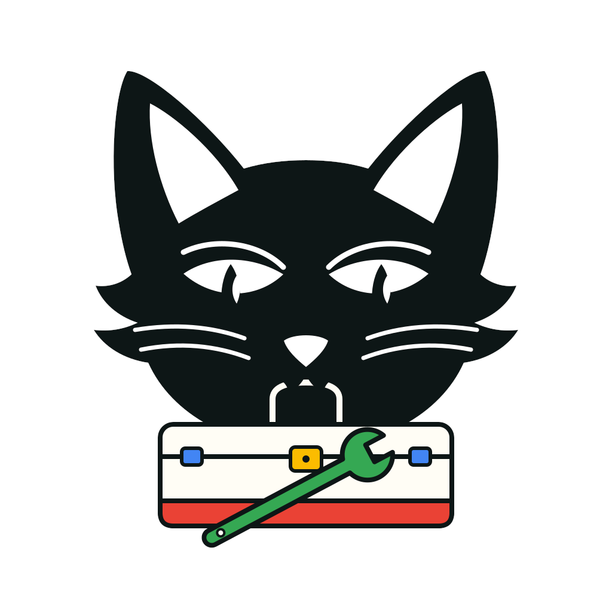

<!-- SPDX-FileCopyrightText: 2026 Blackcat Informatics® Inc. <paudley@blackcatinformatics.ca> -->
<!-- SPDX-License-Identifier: CC-BY-4.0 -->

  

# RAF — Rust Agentic Foundations

RAF provides two tools for Rust repositories. **Workplan** checks that the code, tests and examples named in a capability document resolve, and tracks which sections need review when they change. **Census** finds structurally duplicated helpers and enforces the duplication policy a repository adopts. Both offer a Cargo subcommand and a Rust library for use in integration tests.

## Using the commands in another repository

| To adopt | Start here |
| --- | --- |
| Workplan | Bind a guarantee to its implementation and test, generate the catalogue, run the gate in CI, and reconcile a change. [Workplan how-to](WORKPLAN-HOWTO.md) |
| Census | Inspect a baseline, install a canonical ledger, adopt existing duplication, and catch a new copy. [Census how-to](CENSUS-HOWTO.md) |

The guides pin the CLI and dev-dependency to the same Git revision. The consumer build needs Rust 1.98.1 or newer. RAF uses PurRDF 4 and exact parser requirements for `syn`, `proc-macro2` and `quote`. Check those requirements when adding RAF to an existing dependency graph. [Workspace manifest](Cargo.toml)

## Crates

| Crate | Responsibility |
| --- | --- |
| `raf-workplan`, `cargo-workplan` | Capability documents, generated blocks, coverage, evidence, assessments, review and change completion. [Workplan commands](docs/capabilities/workplan-cli.md) |
| `raf-census`, `cargo-census` | Structural fingerprints, policy jobs, detectors, reference scans, migration and counted debt. [Census commands](docs/capabilities/census-cli.md) |
| `raf-source` | Shared Rust source index for resolving bindings and ledger homes. [Source index](docs/capabilities/source-index.md) |
| `raf-okf` | Parser, writer and closed profile for the authored documents. [OKF profile](docs/capabilities/okf-profile.md) |
| `raf-rdf` | Canonical ground RDF 1.2 reports over native PurRDF storage. [Report profile](docs/capabilities/rdf-report-profile.md) |

RAF runs Workplan against its own documents and Census against its workspace and fuzz roots. The linked tests show the additional policies RAF enforces on itself. The catalogue records the delivery state of each capability, including embedded-clone matching and Rustdoc assembly. [Workplan gate](tests/docs_contract.rs) · [Census gate](tests/self_census.rs) · [Capability catalogue](docs/capabilities/index.md)

## Development

The supported target through the 0.9 release is the primary native Linux target.
Additional targets are subject to reassessment after that release; see
[supported targets](docs/TARGETS.md).

See [CONTRIBUTING.md](CONTRIBUTING.md). Run `make check` before sending a change
and `make hooks` once to install the pre-commit hook. Agents should also read
[AGENTS.md](AGENTS.md).

## Licensing

Code is licensed `MIT OR Apache-2.0 OR MulanPSL-2.0`, and documentation is
licensed CC-BY-4.0. See [LICENSING.md](LICENSING.md) for the full statement.

## Brand

The name, logo and colour system are described in [docs/BRAND.md](docs/BRAND.md).
