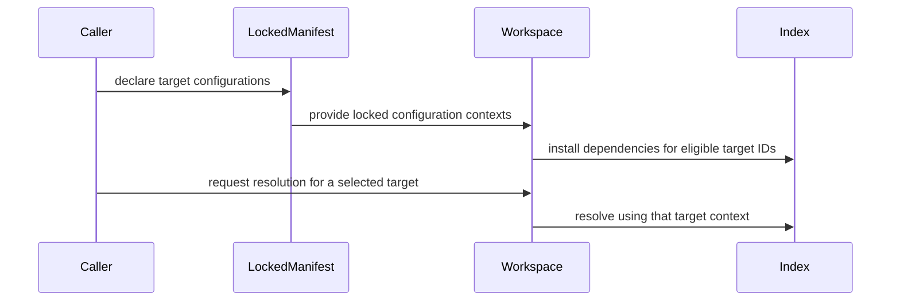

# PR review evidence

Source payload: review-evidence.json
Observed items: 1; PR head: 36a3b703c013331274a2a0de762f45f8345ae092.
Every item needs an explicit disposition; bot comments count.
Dispositions apply to the recorded item revision; edited feedback is reconsidered.

Coverage:
- comments: complete
- reviews: complete
- inline_comments: complete
- threads: complete

## github:comment:IC_kwDOVFffUs8AAAABfC7rNA — coderabbitai (comment)
https://github.com/Blackcat-Informatics/rust-agentic-foundations/pull/62#issuecomment-6378416948
state=None resolved=None path=None

<!-- This is an auto-generated comment: summarize by coderabbit.ai -->
<!-- review_stack_entry_start -->

<a href="https://app.coderabbit.ai/change-stack/Blackcat-Informatics/rust-agentic-foundations/pull/62?cs_source=review_comment"><picture><source media="(prefers-color-scheme: dark)" srcset="https://storage.googleapis.com/coderabbit_public_assets/review-stack-in-coderabbit-ui-dark.svg?v=3"><source media="(prefers-color-scheme: light)" srcset="https://storage.googleapis.com/coderabbit_public_assets/review-stack-in-coderabbit-ui.svg?v=3"></picture></a>

<!-- review_stack_entry_end -->
<!-- recent_review_start -->

No actionable comments were generated in the recent review.

<strong>ℹ️ Recent review info</strong>

<dl>
<dd>

<strong>⚙️ Run configuration</strong>

<dl>
<dd>

- **Source mode**: Auto
- **Repository**: Unavailable
- **Branch**: Unavailable
- **File**: No configuration file from this repository applied
- **Commit**: Unavailable
- **Layers**: Organization UI
- **Review profile**: CHILL
- **Plan**: Advanced
- **Run ID**: `60dae257-0571-4f36-b5aa-6881685bcb43`

</dd>
</dl>

<strong>📥 Commits</strong>

<dl>
<dd>

Reviewing files that changed from the base of the PR and between 8fb0ce319e554a12251936d2b93852bbd2b8411b and 36a3b703c013331274a2a0de762f45f8345ae092.

</dd>
</dl>

<strong>📒 Files selected for processing: 27</strong>

<dl>
<dd>

* `crates/raf-source/src/code.rs`
* `crates/raf-source/src/code/aliases.rs`
* `crates/raf-source/src/code/library.rs`
* `crates/raf-source/src/code/syntax.rs`
* `crates/raf-source/src/configuration.rs`
* `crates/raf-source/src/facts.rs`
* `crates/raf-source/src/impls.rs`
* `crates/raf-source/src/index.rs`
* `crates/raf-source/src/item.rs`
* `crates/raf-source/src/lib.rs`
* `crates/raf-source/src/meter.rs`
* `crates/raf-source/src/modtree.rs`
* `crates/raf-source/src/resolve.rs`
* `crates/raf-source/src/workspace.rs`
* `crates/raf-source/src/workspace/locked.rs`
* `crates/raf-source/tests/code_paths.rs`
* `crates/raf-source/tests/configured_targets.rs`
* `crates/raf-source/tests/load_budgets.rs`
* `crates/raf-source/tests/locked_sources.rs`
* `docs/capabilities/source-index.md`
* `work/assessments/source-index-constraints.md`
* `work/assessments/source-index-contract.md`
* `work/assessments/source-index-examples.md`
* `work/assessments/source-index-explanation.md`
* `work/assessments/source-index-purpose.md`
* `work/assessments/source-index-usage.md`
* `work/assessments/source-index-verification.md`

</dd>
</dl>

**Included review availability:** This review used your included allowance. 9 included reviews remain after this review. Your included PR review attempts over the past 7 days set your current allowance at 10 reviews per hour.

</dd>
</dl>

<!-- recent_review_end -->
<!-- walkthrough_start -->

<strong>📝 Summary</strong>

<dl>
<dd>

<!-- This is an auto-generated comment: release notes by coderabbit.ai -->

## Review summary

* **New Features**
  * Added target-specific configuration support for locked workspaces, including dependency eligibility based on target type, features, and declared conditions.
  * Added queries for available external libraries and checks that resolved definitions are publicly exported.
  * Added lookup for supported type-alias members and applicable inherent methods.
  * Added inspection of source syntax using a target’s configured settings.
  * Added scoped loading of locked sources.
* **Documentation**
  * Expanded source-index guidance with examples and details on configuration, library queries, and syntax inspection.

<!-- end of auto-generated comment: release notes by coderabbit.ai -->
The PR adds target-specific locked configurations and dependency eligibility, bounded code queries for external libraries and associated members, and configured syntax inspection. It also adds tests and capability documentation for these APIs and their refusal cases.

**Changes: Configured target contexts**

|Layer / File(s)|Summary|
|:---|:---|
|**Locked target selection and dependency eligibility**   `crates/raf-source/src/workspace/locked.rs`, `crates/raf-source/src/configuration.rs`, `crates/raf-source/src/workspace.rs`, `crates/raf-source/src/index.rs`, `crates/raf-source/src/meter.rs`, `crates/raf-source/tests/configured_targets.rs`, `crates/raf-source/tests/locked_sources.rs`, `docs/capabilities/source-index.md`|Locked manifests can carry multiple target configurations. Loading validates selected targets and features, records dependency eligibility by target, and adds first-party-root-scoped source loading.|
|**External-library and associated-member resolution**   `crates/raf-source/src/code.rs`, `crates/raf-source/src/code/aliases.rs`, `crates/raf-source/src/code/library.rs`, `crates/raf-source/src/facts.rs`, `crates/raf-source/src/impls.rs`, `crates/raf-source/src/item.rs`, `crates/raf-source/src/resolve.rs`, `crates/raf-source/src/workspace.rs`, `crates/raf-source/src/lib.rs`, `crates/raf-source/tests/code_paths.rs`, `crates/raf-source/tests/load_budgets.rs`, `docs/capabilities/source-index.md`, `work/assessments/source-index-*`|The resolver adds external-library receipts with export checks and bounded alias-member resolution. Resolution records alias chains and applies inherent-method preference when the method meets the recorded applicability conditions.|
|**Configured syntax inspection and file reuse**   `crates/raf-source/src/code/syntax.rs`, `crates/raf-source/src/configuration.rs`, `crates/raf-source/src/modtree.rs`, `crates/raf-source/tests/code_paths.rs`, `crates/raf-source/tests/configured_targets.rs`, `docs/capabilities/source-index.md`|`with_configured_syntax` checks target reachability and uses the selected configuration to filter parsed syntax. Reused file identities require matching package configuration and syntax selections.|

<!-- change_assessment_start -->
<strong>Priority: <picture></picture> High</strong>

**Estimated code review effort:** 4 (Complex) | ~60 minutes

<!-- change_assessment_commit:"36a3b703c013331274a2a0de762f45f8345ae092" -->
**Change:** Feature
<!-- change_assessment_end -->

### Sequence Diagram(s)

**Possibly related issues**
- [Blackcat-Informatics/rust-agentic-foundations#48](https://github.com/Blackcat-Informatics/rust-agentic-foundations/issues/48) — The PR adds configured target sets, dependency eligibility, external identities, and bounded unsupported-case handling described in this issue.
- [Blackcat-Informatics/rust-agentic-foundations#5](https://github.com/Blackcat-Informatics/rust-agentic-foundations/issues/5) — The new Source evidence APIs provide target, dependency, export, and alias information for the reference scans and detectors described in this issue.
- [Blackcat-Informatics/rust-agentic-foundations#53](https://github.com/Blackcat-Informatics/rust-agentic-foundations/issues/53) — The PR adds Source evidence described as a foundation for this issue, but does not add preferred-provider policy or its Census gate.
- [Blackcat-Informatics/rust-agentic-foundations#61](https://github.com/Blackcat-Informatics/rust-agentic-foundations/issues/61) — The PR adds target, identity, export, alias, and resource evidence used by the configured native delegation follow-up.

**Possibly related PRs**
- [Blackcat-Informatics/rust-agentic-foundations#59](https://github.com/Blackcat-Informatics/rust-agentic-foundations/pull/59) — PR `#59` introduced `CodeResolver`; this PR extends its resolver and `Resolution` contracts and retains workspace and load-option references.

</dd>
</dl>

<!-- walkthrough_end -->

<strong>Merge Risk:</strong> <strong><picture></picture> Minimal</strong> · up to <code>36a3b</code>

<dl>
<dd>

<!-- final_review_risk_start -->
<!-- final_review_risk_label
**Merge Risk:** **⚪ Minimal** · up to `36a3b`
-->
<!-- final_review_risk_coverage:{"sourceCommitId":"36a3b703c013331274a2a0de762f45f8345ae092","coveredCommitId":"36a3b703c013331274a2a0de762f45f8345ae092","kind":"reviewed"} -->

This change adds target-configured loading and bounded Source queries. No concrete merge-blocking defect was established in review. The author's reported checks, including the full make check, were still partly pending, which is normal pre-merge validation.
<!-- final_review_risk_end -->

</dd>
</dl>

<strong>Security architecture risk:</strong> <strong><picture></picture> Low</strong> · up to <code>36a3b</code>

<dl>
<dd>

<!-- architecture_review_start -->
<!-- architecture_review_label
### Security Architecture Review

**Security architecture risk:** **🔵 Low** · up to `36a3b`
-->

The inspected paths retain explicit target, dependency-identity, export, and resource checks. No introduced security boundary bypass was established. Risk is low rather than minimal because downstream enforcement and the complete affected surface have not been established.

**Retained concerns**
No architecture-level concerns identified.

<strong>Security review details</strong>

<dl>
<dd>

**Security Blast Radius**
- _inferred_ — The demonstrated exposure is source-analysis correctness and resource consumption within a caller-selected workspace and its supplied dependencies. The inspected consumer resolves indexed identities and propagates query errors; it does not demonstrate a new privileged execution, tenant, or deployment authority.

**Trust Boundaries and Controls**
- _observed_ — Repository-controlled names and syntax do not alone establish an external-library identity. The queries require indexed context, preserve ambiguity, exclude same-package and non-library roots, and check exported definition identity. Configured syntax additionally verifies target-to-file reachability.

**Resilience and Maintainability Implications**
- _inferred_ — Construction failures are contained within local load state rather than exposing a partially configured workspace. Fresh invocations create independent accounting state; inspected recovery preserves typed failures instead of converting exhausted grants into successful evidence.

</dd>
</dl>

<!-- architecture_review_end -->

</dd>
</dl>

<!-- pre_merge_checks_walkthrough_start -->

<strong>Pre-merge checks: <picture></picture> 4 · <picture></picture> 1</strong>

<dl>
<dd>

<strong><picture></picture> Failed checks: 1 warning</strong>

|     Check name     |                                              Status                                              | Explanation                                                                                                                                                                                               | Resolution                                                                         |
| :---------------- | :----------------------------------------------------------------------------------------------: | :-------------------------------------------------------------------------------------------------------------------------------------------------------------------------------------------------------- | :--------------------------------------------------------------------------------- |
| Docstring Coverage |  | Docstring coverage is 30.47% which is insufficient. The required threshold is 80.00%. Docstring coverage is scoped to functions touched by this diff. Analyzed 128 functions across 19 files. (8 skipped… | Write docstrings for the functions missing them to satisfy the coverage threshold. |

<strong><picture></picture> Passed checks: 4 passed</strong>

<dl>
<dd>

|         Check name         |                                             Status                                             | Explanation                                                                                                                                                                                               |
| :------------------------ | :--------------------------------------------------------------------------------------------: | :-------------------------------------------------------------------------------------------------------------------------------------------------------------------------------------------------------- |
|         Title check        |  | The title "feat(source): expose bounded configured code evidence" matches the main change. The changeset adds configured-syntax inspection (`with_configured_syntax`), external-library receipts (`exter… |
|     Linked Issues check    |  | Issue `#60` coding requirements are covered. The implementation adds scoped locked-source loading with first-party association checks and sealed Git-source handling, explicit Lib, Bin, Test, Bench, Exam… |
| Out of Scope Changes check |  | The reviewed changes remain within Issue `#60`. Source implementation, focused tests, capability documentation, and source-index assessment updates directly support the bounded evidence API and its cont… |
|      Description check     |  | The PR description is specific and related to the changeset. It states that configured Source consumers can select binaries, tests, benches and examples, and that development dependencies and filtered… |

<strong>Full details: Title check</strong>

<dl>
<dd>

**Explanation**

The title "feat(source): expose bounded configured code evidence" matches the main change. The changeset adds configured-syntax inspection (`with_configured_syntax`), external-library receipts (`extern_libraries_at`, `ExternLibrary`), and bounded alias/member resolution, all exposed through the source/code API. The title is specific and follows a conventional-commit style. It does not name every change, such as the configuration eligibility rules, which the title does not need to cover.

</dd>
</dl>

<strong>Full details: Linked Issues check</strong>

<dl>
<dd>

**Explanation**

Issue `#60` coding requirements are covered. The implementation adds scoped locked-source loading with first-party association checks and sealed Git-source handling, explicit Lib, Bin, Test, Bench, Example, and BuildScript configurations, feature and dependency eligibility checks, own-library companion checks, and incompatible physical-view refusal. The code adds configured syntax inspection, bounded external-library/export queries, alias-member and unconditional inherent-method resolution, and typed budget/error propagation. `configured_targets.rs` covers target selection, development and conditional/optional edges, syntax reuse/refusal, and exact-budget adjacent refusal. `code_paths.rs` covers names, exports, ambiguity, aliases, definition identity, and query budgets. The PR summary reports warnings-denied compilation and focused integration validation.

</dd>
</dl>

<strong>Full details: Out of Scope Changes check</strong>

<dl>
<dd>

**Explanation**

The reviewed changes remain within Issue `#60`. Source implementation, focused tests, capability documentation, and source-index assessment updates directly support the bounded evidence API and its contract. The changes do not claim or implement the excluded Census provider proof, registered CLI execution, RAF self-gate, general generic substitution, or complete Issue `#48` resolution. The PR description keeps those broader objectives open.

</dd>
</dl>

<strong>Full details: Description check</strong>

<dl>
<dd>

**Explanation**

The PR description is specific and related to the changeset. It states that configured Source consumers can select binaries, tests, benches and examples, and that development dependencies and filtered syntax stay in their declared target contexts. It also says the shared code-query API exposes external-library/public-export identities and bounded alias/member lookup. Those points match the raw summary, which covers configured target selection, the new extern-library receipts (ExternLibrary, extern_libraries_at), alias member resolution, and with_configured_syntax. The description also reports validation results and refers to closing issue `#60`, which is consistent with the objectives. The description does not need to list every file, so it passes the lenient check.

</dd>
</dl>

</dd>
</dl>

<strong>Full details: Docstring Coverage</strong>

<dl>
<dd>

**Explanation**

Docstring coverage is 30.47% which is insufficient. The required threshold is 80.00%. Docstring coverage is scoped to functions touched by this diff. Analyzed 128 functions across 19 files. (8 skipped: 8 unsupported.)

**Resolution**

Write docstrings for the functions missing them to satisfy the coverage threshold.

</dd>
</dl>

</dd>
</dl>

<!-- pre_merge_checks_walkthrough_end -->
<!-- finishing_touch_checkbox_start -->

<strong>✨ Finishing Touches: 💡 1</strong>

<dl>
<dd>

<!-- finishing_touch_suggestion:docstrings -->

<strong>📝 Generate docstrings: 💡</strong>

<dl>
<dd>

- [ ] <!-- {"checkboxId":"3e1879ae-f29b-4d0d-8e06-d12b7ba33d98"} --> Commit to this branch
- [ ] <!-- {"checkboxId":"7962f53c-55bc-4827-bfbf-6a18da830691"} --> Create a new PR

</dd>
</dl>

<strong>🧪 Generate unit tests (beta)</strong>

<dl>
<dd>

- [ ] <!-- {"checkboxId": "6ba7b810-9dad-11d1-80b4-00c04fd430c8", "radioGroupId": "utg-output-choice-group-unknown_comment_id"} --> Commit to this branch
- [ ] <!-- {"checkboxId": "f47ac10b-58cc-4372-a567-0e02b2c3d479", "radioGroupId": "utg-output-choice-group-unknown_comment_id"} --> Create a new PR

</dd>
</dl>

</dd>
</dl>

<!-- finishing_touch_checkbox_end -->

<!-- autopilot:start -->
- [ ] <!-- {"checkboxId":"2708ad07-9f24-4260-9c11-7dc76a49f2e3"} --> <strong title="Keep fixing CodeRabbit findings and required CI, and resolving merge conflicts">Autofix</strong> · Keep fixing CodeRabbit findings and required CI, and resolving merge conflicts
<!-- autopilot:end -->
<!-- tips_start -->

<!-- poem_footer_start -->
A rabbit maps each target’s trail, Through locked configs, paths prevail. Library roots reveal their names, Aliases trace their method claims. Syntax blooms in the chosen view, With bounded steps from start to through.
<!-- poem_footer_end -->

Comment `@coderabbitai help` to get the list of available commands.

<!-- tips_end -->

