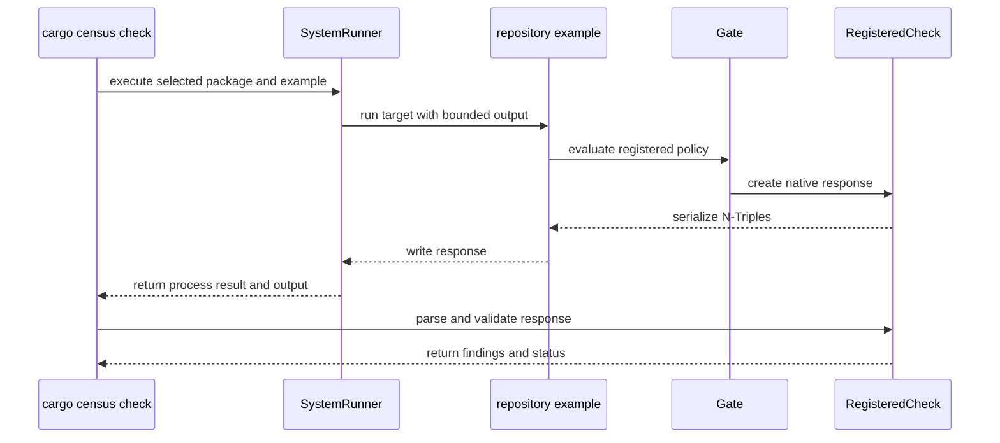

# PR review evidence

Source payload: review-evidence.json
Observed items: 1; PR head: ad4c336a8402280fd819904ff691ad98750f4524.
Every item needs an explicit disposition; bot comments count.
Dispositions apply to the recorded item revision; edited feedback is reconsidered.

Coverage:
- comments: complete
- reviews: complete
- inline_comments: complete
- threads: complete

## github:comment:IC_kwDOVFffUs8AAAABfLgWNA — coderabbitai (comment)
https://github.com/Blackcat-Informatics/rust-agentic-foundations/pull/66#issuecomment-6387406388
state=None resolved=None path=None

<!-- This is an auto-generated comment: summarize by coderabbit.ai -->
<!-- review_stack_entry_start -->

<a href="https://app.coderabbit.ai/change-stack/Blackcat-Informatics/rust-agentic-foundations/pull/66?cs_source=review_comment"><picture><source media="(prefers-color-scheme: dark)" srcset="https://storage.googleapis.com/coderabbit_public_assets/review-stack-in-coderabbit-ui-dark.svg?v=3"><source media="(prefers-color-scheme: light)" srcset="https://storage.googleapis.com/coderabbit_public_assets/review-stack-in-coderabbit-ui.svg?v=3"></picture></a>

<!-- review_stack_entry_end -->
<!-- recent_review_start -->

No actionable comments were generated in the recent review.

<strong><picture></picture> Recent review info</strong>

<dl>
<dd>

<strong><picture><source media="(prefers-color-scheme: dark)" srcset="https://storage.googleapis.com/coderabbit_public_assets/review-comment-icons-v1/cog-dark.svg"></picture> Run configuration</strong>

<dl>
<dd>

- **Source mode**: Auto
- **Repository**: Unavailable
- **Branch**: Unavailable
- **File**: No configuration file from this repository applied
- **Commit**: Unavailable
- **Layers**: Organization UI
- **Review profile**: CHILL
- **Plan**: Advanced
- **Run ID**: `a3b87cfb-1fcb-48d2-854b-c2f7c1cd3fce`

</dd>
</dl>

<strong><picture><source media="(prefers-color-scheme: dark)" srcset="https://storage.googleapis.com/coderabbit_public_assets/review-comment-icons-v1/git-commit-horizontal-dark.svg"></picture> Commits</strong>

<dl>
<dd>

Reviewing files that changed from the base of the PR and between cad18b7f2448a6e9f33e5e821afd59ab548fb658 and ad4c336a8402280fd819904ff691ad98750f4524.

</dd>
</dl>

<strong><picture><source media="(prefers-color-scheme: dark)" srcset="https://storage.googleapis.com/coderabbit_public_assets/review-comment-icons-v1/file-minus-corner-dark.svg"></picture> Files ignored due to path filters: 1</strong>

<dl>
<dd>

* `Cargo.lock` is excluded by `!**/*.lock`

</dd>
</dl>

<strong><picture><source media="(prefers-color-scheme: dark)" srcset="https://storage.googleapis.com/coderabbit_public_assets/review-comment-icons-v1/file-plus-corner-dark.svg"></picture> Files selected for processing: 45</strong>

<dl>
<dd>

* `AGENTS.md`
* `README.md`
* `crates/cargo-census/Cargo.toml`
* `crates/cargo-census/src/cli.rs`
* `crates/cargo-census/src/command.rs`
* `crates/cargo-census/src/error.rs`
* `crates/cargo-census/src/main.rs`
* `crates/cargo-census/src/registered.rs`
* `crates/cargo-census/src/registered/tests.rs`
* `crates/cargo-census/tests/registered.rs`
* `crates/raf-census/examples/registered.rs`
* `crates/raf-census/examples/support/ledger.rs`
* `crates/raf-census/examples/support/registration.rs`
* `crates/raf-census/src/lib.rs`
* `crates/raf-census/src/registered.rs`
* `crates/raf-census/src/registered/tests.rs`
* `crates/raf-census/src/report/mod.rs`
* `crates/raf-census/src/report/shape.rs`
* `crates/raf-census/src/report/write.rs`
* `crates/raf-census/tests/reports.rs`
* `docs/capabilities/census-cli.md`
* `docs/capabilities/census-normal-form.md`
* `docs/capabilities/census-rule-api.md`
* `docs/capabilities/index.md`
* `tests/docs_contract.rs`
* `work/assessments/census-cli-constraints.md`
* `work/assessments/census-cli-contract.md`
* `work/assessments/census-cli-examples.md`
* `work/assessments/census-cli-explanation.md`
* `work/assessments/census-cli-purpose.md`
* `work/assessments/census-cli-usage.md`
* `work/assessments/census-cli-verification.md`
* `work/assessments/census-migration-constraints.md`
* `work/assessments/census-migration-contract.md`
* `work/assessments/census-migration-examples.md`
* `work/assessments/census-migration-explanation.md`
* `work/assessments/census-migration-purpose.md`
* `work/assessments/census-migration-verification.md`
* `work/assessments/census-normal-form-contract.md`
* `work/assessments/census-normal-form-examples.md`
* `work/assessments/census-normal-form-purpose.md`
* `work/assessments/census-normal-form-verification.md`
* `work/assessments/census-rule-api-constraints.md`
* `work/assessments/census-rule-api-examples.md`
* `work/changes/census-cli.md`

</dd>
</dl>

**Included review availability:** This review used your included allowance. 8 included reviews remain after this review. Your included PR review attempts over the past 7 days set your current allowance at 10 reviews per hour.

</dd>
</dl>

<!-- recent_review_end -->
<!-- walkthrough_start -->

<strong>📝 Summary</strong>

<dl>
<dd>

<!-- This is an auto-generated comment: release notes by coderabbit.ai -->

## Review summary

* **New Features**
  * Added `cargo-census check` to run repository-registered checks and report clean results or findings.
  * Check responses are validated, with distinct reporting for evaluation and execution errors.
  * Updated CLI documentation with command usage and behavior, including migration and direct debt recording.
* **Documentation**
  * Updated capability and crate status descriptions to reflect the implemented registered-check workflow.

<!-- end of auto-generated comment: release notes by coderabbit.ai -->
The change adds `cargo census check` for registered repository targets. The Census library defines a bounded native RDF response format, and the CLI runs a selected package example, validates its response, and reports the result.

**Changes: Registered Census checks**

|Layer / File(s)|Summary|
|:---|:---|
|**Native RDF response contract**   `crates/raf-census/src/registered.rs`, `crates/raf-census/src/lib.rs`, `crates/raf-census/src/report/*`, `crates/raf-census/src/registered/tests.rs`, `crates/raf-census/tests/reports.rs`|`RegisteredCheck` encodes and validates bounded, canonical N-Triples responses, including status, ordered findings, and evaluation errors. Report helpers become crate-visible, and report tests group canonical round-trip and closed-shape checks.|
|**Repository-owned registration target**   `crates/raf-census/examples/registered.rs`, `crates/raf-census/examples/support/*`|The example builds a ledger and Gate with a rule and owner extension. It checks clean, finding, and extension-error outcomes and writes the response to stdout.|
|**CLI target execution and response validation**   `crates/cargo-census/Cargo.toml`, `crates/cargo-census/src/*`, `crates/cargo-census/tests/registered.rs`|`cargo census check` accepts a package and example, executes the target through `SystemRunner`, validates its response and exit status, and prints the outcome. Tests cover process and protocol failures, target diagnostics, and read-only behavior.|
|**Capability and verification records**   `AGENTS.md`, `README.md`, `docs/capabilities/*`, `tests/docs_contract.rs`, `work/assessments/*`, `work/changes/census-cli.md`|Documentation and inventory records describe the registered-check capability, response contract, example, and verification references. They also update assessment digests and CLI scope statements.|

<!-- change_assessment_start -->
<strong>Priority: <picture></picture> Normal</strong>

**Estimated code review effort:** 4 (Complex) | ~45 minutes

<!-- change_assessment_commit:"ad4c336a8402280fd819904ff691ad98750f4524" -->
**Change:** Feature
<!-- change_assessment_end -->

### Sequence Diagram(s)

**Possibly related issues**

- `Blackcat-Informatics/rust-agentic-foundations#12` — This change adds a registered CLI execution path; registered debt writing remains outside the described behavior.
- `Blackcat-Informatics/rust-agentic-foundations#40` — The PR adds an RDF machine-readable check response, while the broader workplan and debt conversion remain unimplemented.
- `Blackcat-Informatics/rust-agentic-foundations#6` — This is a bounded registered CLI mode, not the full CLI scope.
- `Blackcat-Informatics/rust-agentic-foundations#53` — The registered check executes through the provider path, but the broader provider-enforcement work remains separate.
- `Blackcat-Informatics/rust-agentic-foundations#5` — The CLI exercises registered Rule and LedgerExtension outcomes through Gate.
- `Blackcat-Informatics/rust-agentic-foundations#61` — The PR invokes a repository target for locked Gate behavior; the broader backend contract remains separate.
- `Blackcat-Informatics/rust-agentic-foundations#65` — This PR establishes a read-only registered-check path; the issue describes follow-up debt writing.

**Possibly related PRs**

- [Blackcat-Informatics/rust-agentic-foundations#63](https://github.com/Blackcat-Informatics/rust-agentic-foundations/pull/63) — It provides the locked-source Gate behavior that this PR’s registered target execution is described as using.

</dd>
</dl>

<!-- walkthrough_end -->

<strong>Merge Risk:</strong> <strong><picture></picture> Minimal</strong> · up to <code>ad4c3</code>

<dl>
<dd>

<!-- final_review_risk_start -->
<!-- final_review_risk_label
**Merge Risk:** **⚪ Minimal** · up to `ad4c3`
-->
<!-- final_review_risk_coverage:{"sourceCommitId":"ad4c336a8402280fd819904ff691ad98750f4524","coveredCommitId":"ad4c336a8402280fd819904ff691ad98750f4524","kind":"reviewed"} -->

The registered check path is mergeable after normal checks; no actionable risk remains identified.
<!-- final_review_risk_end -->

</dd>
</dl>

<strong>Security architecture risk:</strong> <strong><picture></picture> Moderate</strong> · up to <code>ad4c3</code>

<dl>
<dd>

<!-- architecture_review_start -->
<!-- architecture_review_label
### Security Architecture Review

**Security architecture risk:** **🟡 Moderate** · up to `ad4c3`
-->

The command deliberately executes trusted repository code with the caller’s permissions. Complete response validation protects result reporting, but cancellation can leave that code running after the command ends, with continued access to the caller’s files and credentials.

**Retained concerns**
- **Medium · reliability · inferred:** The new check path does not link host cancellation to child termination. On Unix, Cargo starts in a separate process group, and the inspected CLI does not forward interruption or invoke group cleanup when the host terminates. Cargo or the selected target can therefore outlive cancellation and continue caller-authorized filesystem activity. The runner limitation predates this PR, but repository-example execution newly exposes it through cargo-census. Timeout and overflow cleanup are counterevidence for those failure paths, not for host interruption.

<strong>Security review details</strong>

<dl>
<dd>

**Security Blast Radius**
- _inferred_ — Execution starts in one workspace, but its effective authority is not confined there. The selected code can access files, inherited environment credentials and resources available to the invoking user or CI identity. No higher OS privilege is explicitly requested by the inspected path.

**Security Findings and Attack Paths**
- _inferred_ — An actor controlling the selected repository executable can control behavior before any response is validated. That is the explicitly documented trust assumption, not a demonstrated injection or sandbox-escape finding. The retained concern is narrower: cancellation can fail to end this newly introduced execution relationship.

**Trust Boundaries and Controls**
- _observed_ — Validated package/example names and shell-free argv separate selection from shell interpretation. The fixed frozen invocation constrains Cargo dependency resolution; bounded capture, strict decoding and exit agreement constrain what the host accepts as a check result. None of these controls limits arbitrary target permissions.

**Resilience and Maintainability Implications**
- _observed_ — The real-target fixture compares direct Gate results with CLI results across clean, finding, owner-refusal, missing-target and build-failure cases. Its read-only assertions cover six enumerated files and absence of census-debt.ttl; they do not establish complete filesystem immutability, interruption cleanup or concurrent-execution isolation.

**Hardening Proposals**
- _proposed_ — Link cancellation to platform-appropriate descendant termination and qualify interruption behavior explicitly. If execution of untrusted repositories becomes a supported use case, introduce a separate least-privilege execution boundary with restricted credentials rather than treating frozen Cargo or response validation as isolation.

</dd>
</dl>

<!-- architecture_review_end -->

</dd>
</dl>

<!-- pre_merge_checks_walkthrough_start -->

<strong>Pre-merge checks: <picture></picture> 3 · <picture></picture> 1 · <picture></picture> 1</strong>

<dl>
<dd>

<strong><picture></picture> Failed checks: 1 warning · 1 inconclusive</strong>

|      Check name     |                                                   Status                                                   | Explanation                                                                                                                                                                                               | Resolution                                                                                                                                                                                                                                        |
| :----------------- | :--------------------------------------------------------------------------------------------------------: | :-------------------------------------------------------------------------------------------------------------------------------------------------------------------------------------------------------- | :------------------------------------------------------------------------------------------------------------------------------------------------------------------------------------------------------------------------------------------------ |
|  Docstring Coverage |            | Docstring coverage is 8.11% which is insufficient. The required threshold is 80.00%. Docstring coverage is scoped to functions touched by this diff. Analyzed 74 functions across 18 files. (27 skipped:… | Write docstrings for the functions missing them to satisfy the coverage threshold.                                                                                                                                                                |
| Linked Issues check |  | Direct issue `#64` has coding requirements. The change summary supplies evidence for most of them. The cargo-census CLI adds a `check` subcommand with required `--package` and `--example` values. `regis… | Provide the locked-source integration fixture and its test source, including the DiskTree manifest and lock inputs and the test that checks approved native delegation, decorative native calls, and unlisted competing code. Provide the code t… |

<strong><picture></picture> Passed checks: 3 passed</strong>

<dl>
<dd>

|         Check name         |                                             Status                                             | Explanation                                                                                                                                                                                               |
| :------------------------ | :--------------------------------------------------------------------------------------------: | :-------------------------------------------------------------------------------------------------------------------------------------------------------------------------------------------------------- |
|         Title check        |  | The title clearly and concisely describes the main change: running repository-owned registered checks through the Census CLI.                                                                             |
| Out of Scope Changes check |  | The changed files map to `#64` or to the capability lifecycle that `#64` requires. The CLI `check` subcommand, `command.rs` dispatch, `error.rs` exit mapping, `main.rs` error handling, and `registered.rs`… |
|      Description check     |  | The pull request description directly explains the new registered `cargo census check` command, protocol validation, runner behavior, tests, and stated scope. It matches the changeset.                  |

<strong>Full details: Out of Scope Changes check</strong>

<dl>
<dd>

**Explanation**

The changed files map to `#64` or to the capability lifecycle that `#64` requires. The CLI `check` subcommand, `command.rs` dispatch, `error.rs` exit mapping, `main.rs` error handling, and `registered.rs` host runner implement the check path. The `raf_census` `registered.rs` codec and its tests implement the native protocol. The example registration and support files, and the integration test, supply the required real fixtures. Visibility changes from `pub(super)` to `pub(crate)` in `report/shape.rs`, `report/write.rs`, and `report/mod.rs` expose the existing scalar and profile helpers that the new codec uses. The consolidation of report tests in `tests/reports.rs` keeps the prior assertion bodies, as the PR description states. The README, `AGENTS.md`, `docs/capabilities/*`, `work/assessments/census-cli-*` and `census-migration-*` digests, `work/changes/census-cli.md`, and `tests/docs_contract.rs` updates record the capability status change to implementing and the required assessments. The `raf-workplan` dependency in `crates/cargo-census/Cargo.toml` has no stated purpose in the summary. The `syn` and `toml` dev-dependencies support test fixtures. No demonstrated change falls outside `#64`. The `raf-workplan` purpose is a minor open question, not a demonstrated unrelated change.

</dd>
</dl>

</dd>
</dl>

<strong>Full details: Docstring Coverage</strong>

<dl>
<dd>

**Explanation**

Docstring coverage is 8.11% which is insufficient. The required threshold is 80.00%. Docstring coverage is scoped to functions touched by this diff. Analyzed 74 functions across 18 files. (27 skipped: 27 unsupported.)

**Resolution**

Write docstrings for the functions missing them to satisfy the coverage threshold.

</dd>
</dl>

<strong>Full details: Linked Issues check</strong>

<dl>
<dd>

**Explanation**

Direct issue `#64` has coding requirements. The change summary supplies evidence for most of them. The cargo-census CLI adds a `check` subcommand with required `--package` and `--example` values. `registered.rs` runs the package/example through `SystemRunner` with output capped at `MAX_CHECK_RESPONSE_BYTES`. It rejects exit codes other than 0 or 1, rejects output that is not valid UTF-8 or does not parse, and rejects exit/outcome disagreement. `raf_census::registered` adds `CHECK_PROTOCOL_VERSION`, a closed canonical N-Triples `RegisteredCheck` codec that keeps finding order and multiplicity, and rejection of invalid version, shape, counts, orphan findings, and noncanonical or oversized input. The example `registered.rs` and `support/registration.rs` register a Rule and a LedgerExtension. `tests/registered.rs` runs the CLI from a separate caller directory with an explicit workspace root. It checks clean output, read-only parity, findings after a local copy, a mismatched ledger owner, an absent example, and a target that fails to compile. Evidence is missing for these parts of `#64`: (1) The locked-source acceptance: no fixture in the summary reaches configured native provider execution through the CLI. The PR description names a DiskTree fixture with the pinned PurRDF Hasher and an unlisted competitor check, but no such file or test appears in the summary. Approved delegation, decorative native calls, and unlisted competing code are therefore unverified. (2) The argv contract: the summary does not show `--locked`, the `--` separator before protocol arguments, or reuse of `Invocation::example_run`. (3) The repository assessment could not be inspected directly in this review, so these points rest on the summary alone.

**Resolution**

Provide the locked-source integration fixture and its test source, including the DiskTree manifest and lock inputs and the test that checks approved native delegation, decorative native calls, and unlisted competing code. Provide the code that builds the cargo argv for the registered check, showing `--locked`, `--package`, `--example`, the workspace-root cwd, and the `--` separator, and showing that it calls the frozen `Invocation::example_run` seam. With this evidence the assessment can be decided.

</dd>
</dl>

</dd>
</dl>

<!-- pre_merge_checks_walkthrough_end -->
<!-- finishing_touch_checkbox_start -->

<strong>Finishing Touches: 💡 1</strong>

<dl>
<dd>

<!-- finishing_touch_suggestion:docstrings -->

<strong>📝 Generate docstrings: 💡</strong>

<dl>
<dd>

- [ ] <!-- {"checkboxId":"3e1879ae-f29b-4d0d-8e06-d12b7ba33d98"} --> Commit to this branch
- [ ] <!-- {"checkboxId":"7962f53c-55bc-4827-bfbf-6a18da830691"} --> Create a new PR

</dd>
</dl>

<strong>🧪 Generate unit tests (beta)</strong>

<dl>
<dd>

- [ ] <!-- {"checkboxId": "6ba7b810-9dad-11d1-80b4-00c04fd430c8", "radioGroupId": "utg-output-choice-group-unknown_comment_id"} --> Commit to this branch
- [ ] <!-- {"checkboxId": "f47ac10b-58cc-4372-a567-0e02b2c3d479", "radioGroupId": "utg-output-choice-group-unknown_comment_id"} --> Create a new PR

</dd>
</dl>

</dd>
</dl>

<!-- finishing_touch_checkbox_end -->

<!-- autopilot:start -->
- [ ] <!-- {"checkboxId":"2708ad07-9f24-4260-9c11-7dc76a49f2e3"} --> <strong title="Keep fixing CodeRabbit findings and required CI, and resolving merge conflicts">Autofix</strong> · Keep fixing CodeRabbit findings and required CI, and resolving merge conflicts
<!-- autopilot:end -->
<!-- tips_start -->

<!-- poem_footer_start -->
A rabbit checks the ledger’s lines   And sends clean RDF through the pines   If findings hop into the stream   The CLI reports each in sequence   Then leaves the source untouched and neat
<!-- poem_footer_end -->

Comment `@coderabbitai help` to get the list of available commands.

<!-- tips_end -->

Disposition for github:comment:IC_kwDOVFffUs8AAAABfLgWNA: reviewed complete final narrative; no candidate regression or false cancellation promise found. Inherited Runner lifetime limitation remains explicitly owned47, including posted registered-caller mapping. Docstring heuristic and evidence-visibility warnings adjudicated in tasks/hosted-review-disposition.md; real native witness/source and full local acceptance retained. No inline reviews or unresolved threads.
